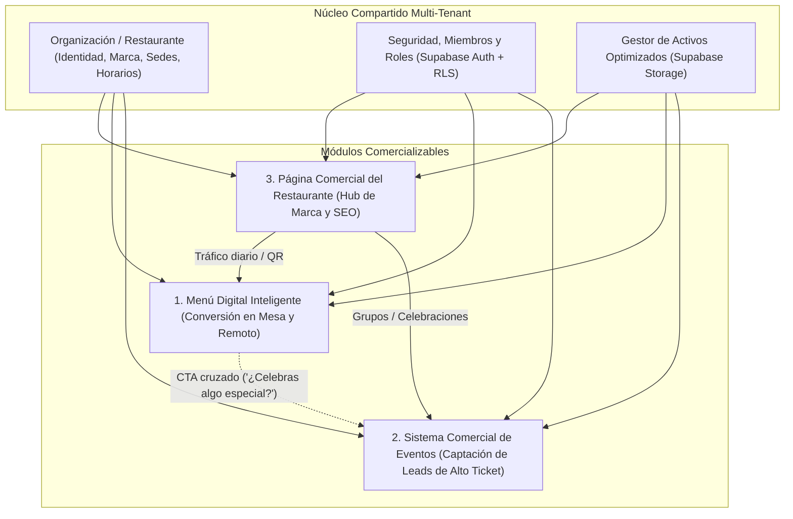
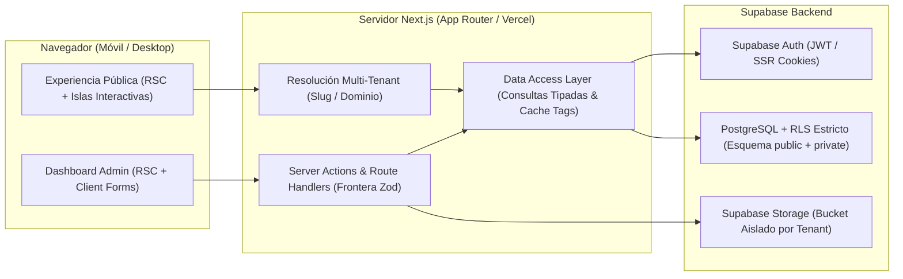
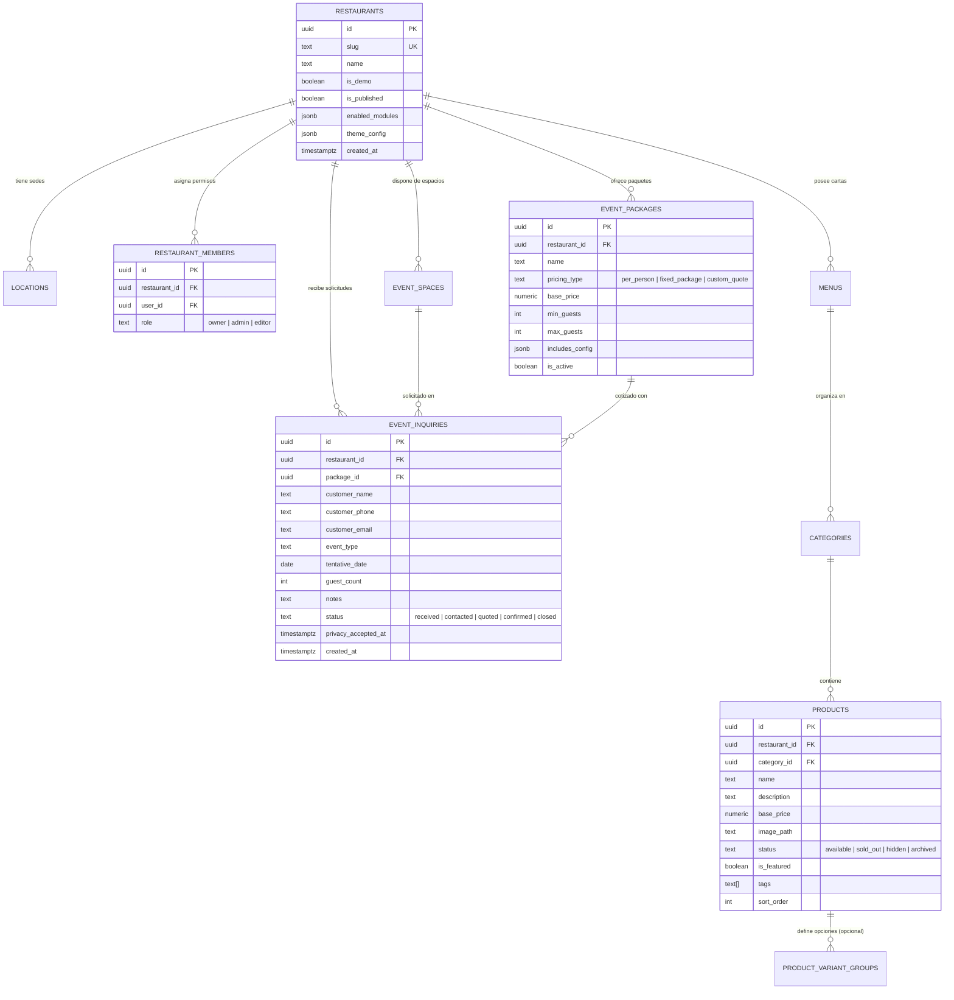

# Análisis Integral de Producto, Arquitectura y Estrategia de Ingeniería

> **Documento base de inicialización del proyecto**  
> **Fuente analizada:** [BRIEF_MAESTRO_PLATAFORMA_RESTAURANTES.md](file:///Users/fenbsru/Downloads/BRIEF_MAESTRO_PLATAFORMA_RESTAURANTES.md)  
> **Enfoque:** Equipo multidisciplinario (Product, Architecture, Full-Stack, UI/UX, QA, Security, Tech Lead)  
> **Estado:** Fase 0 — Pensamiento crítico, alineación arquitectónica y definición de decisiones bloqueantes (sin código).

---

## 1. Comprensión del Proyecto (`Product Architect`)

### 1.1 ¿Qué negocio estamos construyendo?
No estamos construyendo una agencia de diseño web que entrega proyectos artesanales hechos desde cero para cada cliente, ni tampoco un SaaS masivo de autoservicio (*self-serve*) donde el dueño de un restaurante entra solo, se frustra configurando 50 pantallas y abandona al tercer día.

Estamos construyendo una **plataforma tecnológica B2B de comercialización consultiva (*Productized SaaS / High-Touch Platform*) para el sector gastronómico**. El modelo de negocio combina:
1. **Un núcleo tecnológico único, multi-tenant y reutilizable** (bajo coste marginal de despliegue y mantenimiento).
2. **Una venta e implementación consultiva basada en demostraciones reales**, donde el propietario ve funcionando una solución concreta para su dolor operativo o comercial más urgente y paga de forma transparente por configuración inicial, personalización de marca y operación continua.

### 1.2 ¿Qué problema real resolvemos?
El problema tiene dos caras simétricas:

| Actor | Fricción actual en restaurantes independientes | Solución que entrega la plataforma |
|---|---|---|
| **Comensal / Cliente de Eventos** | Menús en PDF pesados, ilegibles en móvil y con precios desactualizados; enlaces rotos en Instagram; incertidumbre total sobre si el restaurante atiende eventos, qué capacidad tiene o cuánto cuesta aproximadamente un paquete de celebración. | Una experiencia móvil instantánea (QR o enlace), legible, con disponibilidad real al día, y un dossier interactivo de eventos que le permite entender paquetes y enviar una solicitud estructurada en menos de 90 segundos. |
| **Propietario / Administrador** | Dependencia de diseñadores o terceros para cambiar un precio o pausar un plato agotado; pérdida de oportunidades de alto ticket (cumpleaños, eventos corporativos) porque las consultas por WhatsApp llegan incompletas, se responden tarde o quedan enterradas en el chat. | Autonomía operativa desde un panel claro para actualizar precios, productos y disponibilidad en segundos, junto con un sistema que filtra, estructura y registra cada oportunidad comercial de eventos. |

### 1.3 Los tres productos y cómo se relacionan entre sí
Aunque comercialmente pueden venderse por separado según la urgencia del restaurante, técnicamente son **tres módulos acoplados a un mismo núcleo de identidad, sedes y activos digitales**:



1. **Menú Digital Inteligente:** Es el motor de alta frecuencia. Resuelve la operación diaria en mesa (QR) y consulta previa por redes sociales.
2. **Sistema Comercial de Eventos y Celebraciones:** Es el motor de **alto ticket y alto margen**. Un solo evento corporativo o celebración familiar de 30 personas que se cierre gracias a una presentación clara y una captura estructurada de la solicitud puede pagar meses de suscripción de la plataforma para el restaurante.
3. **Página Comercial del Restaurante:** Es el **tejido conectivo y escaparate editorial**. Posiciona la propuesta gastronómica en buscadores y redes, presenta sedes y horarios, y dirige al visitante hacia los dos puntos de conversión: consultar la carta o cotizar un evento.

### 1.4 ¿Qué diferencia nuestra propuesta de vender simplemente páginas web?
- **Datos estructurados vs. maquetación estática:** En una web tradicional, un plato o paquete de evento es texto e imagen incrustados en una página; aquí son entidades relacionales vivas que pueden filtrarse, agotarse con un toque, reordenarse y auditarse.
- **Autonomía en servicio real:** El restaurante puede desactivar un plato agotado un sábado a las 1:30 p. m. desde el móvil y ver el cambio reflejado en el QR de las mesas en menos de un segundo.
- **Captura comercial estructurada vs. botón genérico de WhatsApp:** En lugar de un botón flotante que abre un chat en blanco ("Hola, info"), el módulo de eventos educa al cliente sobre capacidades, mínimos de asistentes y precios base antes de capturar una solicitud con datos completos.
- **Evolución continua sobre una sola base de código:** Cada mejora de rendimiento, accesibilidad o funcionalidad beneficia a todos los restaurantes de la plataforma sin reconstruir proyectos individuales.

---

## 2. Evaluación Crítica del Brief (`Product` + `Architecture` + `Security`)

### 2.1 Decisiones muy acertadas del documento
1. **Frontera explícita frente a la transaccionalidad (Pedidos, Pagos, Domicilios y Reservas Confirmadas):** Es la mejor decisión estratégica del [BRIEF_MAESTRO_PLATAFORMA_RESTAURANTES.md](file:///Users/fenbsru/Downloads/BRIEF_MAESTRO_PLATAFORMA_RESTAURANTES.md#L83-L116). Evitar pagos en línea, logística de entrega y bloqueos de calendario en tiempo real en la etapa inicial reduce el riesgo técnico y operativo en un 80%, permitiéndonos entregar un producto impecable en presentación y conversión consultiva.
2. **Multi-tenancy lógico en una sola base de datos PostgreSQL con RLS:** Descartar una base de datos por restaurante evita la fragmentación de migraciones y mantiene costes fijos predecibles.
3. **Ética en analítica y estados de confirmación:** Diferenciar una *solicitud de evento* de una *reserva confirmada*, y un *clic en WhatsApp* de una *venta realizada*, protege al restaurante de sobrevender su salón y protege nuestro negocio de promesas comerciales falsas.
4. **Enfoque en demostraciones honestas con marcas ficticias:** Permite vender con evidencia tangible desde el día uno sin infringir propiedad intelectual de terceros.

### 2.2 Aspectos que necesitan mayor definición (Puntos ciegos actuales)
1. **El modelo de herencia entre Restaurante (`restaurant`) y Sede (`location`):**
   El brief menciona que un restaurante puede tener varias sedes y, eventualmente, precios o menús distintos por sede. En ingeniería de bases de datos, esto cambia radicalmente las consultas:
   - *Escenario A (Recomendado para iniciar):* El restaurante tiene múltiples sedes (`locations` con su propia dirección, horarios, fotos y WhatsApp), y cada `menu` puede ser global del restaurante o asignarse opcionalmente a una sede específica (`location_id NULLABLE`).
   - *Escenario B (Complejidad alta):* Un mismo producto tiene una tabla pivote `product_location_overrides` con precios y estados de agotado distintos por sucursal. Construir esto sin tener aún un cliente multi-sede con precios diferenciados complicará innecesariamente el dashboard administrativo.
2. **El mecanismo de persistencia vs. canal de notificación en Eventos:**
   El brief plantea como duda si las solicitudes de eventos se envían a WhatsApp o se registran en el dashboard. **Cuestionamiento crítico:** Si confiamos únicamente en abrir un enlace `wa.me/` desde el navegador del cliente, perderemos entre el 20% y el 40% de los leads (usuarios que llenan el formulario pero no pulsan "Enviar" dentro de WhatsApp, o cuyo navegador bloquea el redireccionamiento). **Toda solicitud debe guardarse primero de forma atómica en PostgreSQL (`event_inquiries`)** y, acto seguido, ofrecer la confirmación en pantalla junto con la opción de continuar la conversación por WhatsApp y/o notificar al restaurante.
3. **El flujo de aprovisionamiento (Onboarding de nuevos clientes y Demo):**
   Como no somos un SaaS abierto donde cualquiera crea un restaurante gratis desde una pantalla pública de registro, necesitamos definir cómo se da de alta un nuevo `restaurant` y su primer usuario `owner` sin dejar endpoints abiertos ni depender de editar tablas delicadas a mano en producción.

### 2.3 Riesgos técnicos, de diseño y comerciales identificados

> [!WARNING]
> **Riesgo Comercial #1: La realidad fotográfica de los restaurantes reales**  
> En nuestra demo ficticia tendremos fotografías editoriales perfectas. Sin embargo, cuando implementemos el primer restaurante cliente, es muy probable que solo tenga buenas fotos para el 30% de su carta (y ninguna para bebidas, adiciones o licores).  
> **Mitigación obligatoria:** El sistema de diseño del Menú Digital debe ser **asimétrico e inteligente**: debe lucir extraordinario tanto en categorías con fotografía protagonista como en categorías 100% tipográficas, sin mostrar recuadros grises vacíos ni íconos genéricos de "sin imagen".

> [!CAUTION]
> **Riesgo Técnico #1: Pausa por inactividad en Supabase Free durante demos comerciales**  
> Los proyectos en Supabase Free se pausan automáticamente tras 7 días sin actividad en base de datos, tardando varios minutos en restaurarse desde el panel de Supabase. Ir a una reunión presencial con el dueño de un restaurante y encontrar la demo caída es inaceptable.  
> **Mitigación:** Mantener un monitoreo/actividad periódica controlada durante la fase de demostración y migrar a Supabase Pro en el momento exacto en que entre el primer cliente productivo.

> [!IMPORTANT]
> **Riesgo Legal y de Seguridad (Colombia — Ley 1581 de 2012 / Habeas Data):**  
> El formulario de eventos captura datos personales (nombre, teléfono, correo). Aunque sea un MVP o primera versión productiva, el formulario público debe incluir el check obligatorio de aceptación de política de tratamiento de datos y registrar la marca de tiempo (`privacy_accepted_at` en `TIMESTAMPTZ`), además de contar con protección anti-spam (`rate limiting` + `honeypot` o Turnstile) para evitar que bots inunden el dashboard o el WhatsApp del restaurante.

### 2.4 Qué evitar construir prematuramente (Anti-Scope Creep)
Para proteger la velocidad y la excelencia visual de la primera versión, recomendamos **excluir explícitamente** del alcance inicial:
1. **Motor de visibilidad automática por horarios/días de la semana (Cron/Timezone rules):** Mostrar una etiqueta clara en la categoría (*"Servido todos los días de 8:00 a. m. a 11:30 a. m."*) resuelve el 99% de la necesidad sin ocultar la carta a quien la consulta de noche para planear su visita del día siguiente.
2. **Subcategorías anidadas recursivas ($N$ niveles):** En pantallas móviles, más de dos niveles de jerarquía (*Menú/Sección → Categoría → Producto*) degrada la experiencia táctil.
3. **Constructor visual libre (Drag & Drop de bloques / selector libre de fuentes y colores HEX):** Garantiza que el usuario final romperá la armonía visual. Usaremos **configuración estructurada sobre arquetipos de diseño curados**.
4. **Sincronización bidireccional en vivo con Google Sheets:** Usaremos importación/exportación estructurada (CSV/plantilla validada con Zod) para cargas iniciales, no Google Sheets como base de datos en tiempo real.

---

## 3. Arquitectura Propuesta (`Software Architect` + `Full-Stack` + `Security`)

> [!NOTE]
> A continuación se presenta la **arquitectura recomendada** para discusión y validación. Ninguna de estas piezas se dará por cerrada hasta que confirmemos las decisiones de la Sección 7.

### 3.1 Arquitectura General (Monolito Modular en Next.js App Router)
Proponemos una arquitectura limpia de tres capas dentro de un único repositorio Next.js (App Router + TypeScript estricto):



- **Separación estricta de responsabilidades:**
  - Los componentes visuales (`src/components/`, `src/app/`) **nunca** importan el cliente de Supabase directamente ni escriben consultas SQL/PostgREST.
  - La capa de acceso a datos (`src/lib/dal/` o `src/modules/*/queries.ts` y `mutations.ts`) centraliza todas las lecturas y escrituras, aplicando esquemas `Zod` en cada límite de confianza.
  - Uso de **React Server Components (RSC)** por defecto en toda la experiencia pública del restaurante, el menú y la página de eventos, reservando `"use client"` exclusivamente para: buscador/filtros instantáneos del menú en memoria, `Drawer` de detalle de producto, selector de paquetes/formulario de eventos y controles interactivos del dashboard.

### 3.2 Organización Multi-Tenant y Resolución de Rutas
- **Recomendación:** Iniciar con enrutamiento por **slug semántico** bajo una estructura limpia (ej. `/[restaurantSlug]`, `/[restaurantSlug]/menu`, `/[restaurantSlug]/eventos`) y el panel administrativo en `/dashboard/[restaurantSlug]/...`.
- **Por qué:** Permite compartir enlaces de demostración inmediatamente (`tudominio.com/casa-brasa/menu`), generar códigos QR por restaurante o sede sin configurar DNS, y probar todo en entornos Preview de Vercel. Si más adelante un restaurante contrata dominio propio (`www.restaurantecliente.com`), un `middleware.ts` / `proxy.ts` de Next.js reescribe internamente el host hacia `/[restaurantSlug]` sin tocar un solo componente ni consulta de base de datos.

### 3.3 Modelo Conceptual de Datos (PostgreSQL 3NF + Desnormalización de `restaurant_id` para RLS)
Siguiendo las mejores prácticas de PostgreSQL:
- **Claves primarias:** `UUID` (`gen_random_uuid()`) en todas las entidades expuestas para evitar ataques de enumeración secuencial.
- **Precios y moneda:** `NUMERIC(12, 2)` con `CHECK (price >= 0)` (nunca `FLOAT` ni `MONEY`).
- **Fechas y tiempos:** `TIMESTAMPTZ NOT NULL DEFAULT now()` en todas las tablas.
- **Claves foráneas e índices:** PostgreSQL no indexa automáticamente las claves foráneas; crearemos índices B-tree compuestos empezando siempre por `restaurant_id` (ej. `CREATE INDEX idx_products_tenant_cat_order ON public.products (restaurant_id, category_id, sort_order)`).
- **Desnormalización intencional de `restaurant_id`:** Todas las tablas hijas (`categories`, `products`, `event_packages`, `event_inquiries`) incluyen `restaurant_id UUID NOT NULL REFERENCES public.restaurants(id) ON DELETE CASCADE`. Esto permite que las políticas RLS verifiquen pertenencia directamente contra un índice local sin ejecutar `JOIN`s costosos en cada fila leída.



### 3.4 Autenticación, Autorización y Políticas RLS (`Security Engineer`)
Para garantizar un aislamiento multi-tenant real en Supabase y evitar las trampas de seguridad documentadas en PostgreSQL:

1. **Prohibición absoluta de `user_metadata` para control de acceso:** Jamás leeremos roles ni `restaurant_id` desde `raw_user_meta_data` del JWT, porque cualquier usuario autenticado puede alterar su propio `user_metadata` desde el cliente. La única fuente de verdad será la tabla `public.restaurant_members`.
2. **Funciones de autorización en esquema `private` (No expuesto en la API):**
   Crearemos una función `private.has_restaurant_role(target_restaurant_id uuid, allowed_roles text[])` declarada con `SECURITY DEFINER` y `SET search_path = ''`, revocando `EXECUTE` a `PUBLIC` y `anon`. Dentro de la política RLS se invocará envuelta en un `SELECT` escalar (`(SELECT private.has_restaurant_role(restaurant_id, ARRAY['owner','admin','editor']))`) para que el optimizador de PostgreSQL cachee el resultado por consulta (`initPlan`) en lugar de reevaluarlo fila por fila.
3. **Políticas explícitas por rol (`TO anon`, `TO authenticated`) y doble control en `UPDATE`:**
   - Nunca usaremos `auth.role()` (deprecado en Supabase).
   - Toda política `FOR UPDATE` tendrá obligatoriamente `USING (...)` **y** `WITH CHECK (...)` idénticos o más restrictivos, impidiendo que un usuario malintencionado modifique el campo `restaurant_id` de un registro propio para inyectarlo en otro restaurante.
4. **Protección de `event_inquiries` (Datos personales de clientes):**
   - El rol `anon` **no tendrá política `SELECT`** sobre `event_inquiries`.
   - Recomendamos realizar la creación de solicitudes de eventos a través de una **Server Action en Next.js** (con validación Zod, honeypot anti-bots y control de tasa de envío), de modo que ni siquiera sea necesario abrir `INSERT` directo en la Data API pública para usuarios anónimos, o bien restringir el `INSERT` con restricciones `CHECK` estrictas.

### 3.5 Gestión de Archivos e Imágenes (`Supabase Storage`)
- **Estructura de Bucket:** Un bucket `restaurant-assets` con convención de rutas obligatoria:
  `{restaurant_id}/{module}/{entity_id}/{uuid_v4}.webp`
- **Políticas de Storage:**
  - Lectura pública (`SELECT`) únicamente para carpetas de activos públicos (`menu/`, `site/`, `events/`).
  - Escritura y reemplazo (`INSERT`, `SELECT`, `UPDATE`, `DELETE` — requeridos conjuntamente por Supabase Storage para operaciones de reemplazo/upsert) restringidos a `TO authenticated` comprobando que `(storage.foldername(name))[1]::uuid` pertenezca a un restaurante donde el usuario tenga rol `owner`, `admin` o `editor`.
- **Higiene de archivos:** Validación en cliente y servidor de tipo MIME (`image/jpeg`, `image/png`, `image/webp`, `image/avif`), conversión a WebP/AVIF y límite de dimensiones (máx. 1600px de lado mayor para galerías y 800px para miniaturas de productos) antes de subir al bucket.

### 3.6 Estrategia de Caché y Actualización del Menú Público
- **Problema:** Si cacheamos estáticamente por tiempo fijo (ej. 1 hora), cuando se agote un plato en la cocina el menú seguirá mostrándolo disponible durante 59 minutos. Si no cacheamos nada (`force-dynamic` en cada request), penalizamos la velocidad en móvil y consumimos cuota de base de datos innecesariamente.
- **Solución recomendada:** **Cache por Etiquetas con Revalidación Instantánea (`unstable_cache` / `use cache` + `revalidateTag` en Next.js)**.
  - Las consultas públicas del menú se etiquetan con `tenant:${restaurantSlug}:menu`.
  - El menú público se sirve desde caché en milisegundos.
  - En el instante en que el administrador pulsa "Agotado" o cambia un precio en el Dashboard, la Server Action actualiza Supabase y ejecuta `revalidateTag('tenant:${restaurantSlug}:menu')`, invalidando la caché globalmente de forma inmediata.

---

## 4. Estrategia de Producto: Modularidad y Reutilización (`Product Architect`)

Para cumplir la premisa de *"no reconstruir cada solución desde cero"* y tampoco *"obligar a todos los restaurantes a usar todos los módulos"*, dividimos la plataforma en tres niveles:

| Nivel | Componentes incluidos | Comportamiento comercial y técnico |
|---|---|---|
| **1. Núcleo Obligatorio (Core Platform)** | • Perfil del restaurante (`restaurants`) y sedes (`locations`)<br>• Motor de Tokens Visuales y Arquetipos de Marca<br>• Autenticación, miembros y permisos RLS<br>• Generador de QR y enlaces directos<br>• Gestor de archivos optimizados | Presente en todos los clientes. Permite dar de alta un nuevo restaurante en minutos mediante configuración y datos semilla. |
| **2. Módulos Independientes (`Feature Modules`)** | • **`menu`:** Carta digital, categorías, productos, variantes, buscador, modo servicio rápido.<br>• **`events`:** Espacios, paquetes comerciales, galería de montajes, capturador de solicitudes y embudo de seguimiento.<br>• **`site`:** Portada editorial, historia, galería general, mapa de sedes, SEO local y enrutamiento a módulos activos. | Se activan por configuración en `restaurants.enabled_modules`. Si un restaurante contrata **solo Menú Digital**, la navegación pública oculta "Eventos" y la raíz del restaurante puede mostrar directamente el Menú Digital sin páginas intermedias. |
| **3. Capa Configurable por Restaurante (Data-Driven)** | • Paleta semántica (dentro de rangos de contraste validados) y par tipográfico curado.<br>• Moneda, formato de precios y textos legales/notas de servicio (ej. propina voluntaria, advertencia de alérgenos).<br>• Tipos de eventos que atiende el local y reglas de aforo mínimo/máximo.<br>• Destino de contacto (WhatsApp por sede / correo) y plantilla del mensaje prellenado. | Todo vive en base de datos (`theme_config`, `settings_config` validados con esquemas Zod). **Cero `if (restaurant === 'cliente_x')` en el código fuente.** |

---

## 5. Dirección Visual Propuesta (`UI/UX Designer`)

Para alejarnos radicalmente de las plantillas SaaS genéricas y de los menús digitales que parecen clones baratos de apps de domicilios, proponemos la dirección estética: **"Hospitalidad Editorial & Precisión Operativa"**.

### 5.1 Principios visuales rectores (No negociables)
1. **Asimetría Fotográfica Inteligente (El fin de las tarjetas vacías):**
   En lugar de forzar una cuadrícula uniforme donde cada plato exige una foto cuadrada, el menú combina dos patrones visuales de alta gastronomía:
   - **Platos Destacados / Con Fotografía:** Tarjetas editoriales con fotografía en proporción `4:3` o `1:1`, luz natural, badges discretos y microinteracción sutil al abrir el detalle.
   - **Platos sin Fotografía / Bebidas / Vinos:** Maquetación de **carta impresa contemporánea** (nombre del plato con jerarquía tipográfica clara, descripción breve en tono piedra, precio alineado a la derecha en números tabulares `tabular-nums`). Si un plato no tiene foto, el diseño se ve intencional y elegante, nunca incompleto.
2. **Tipografía con Personalidad Gastronómica + Números Tabulares:**
   - Los títulos de sección y nombres del restaurante utilizan una fuente Display con carácter editorial (serif de contraste moderado o grotesque refinada según el arquetipo del restaurante).
   - La interfaz de lectura rápida, ingredientes y precios utiliza una Sans de máxima legibilidad con `font-variant-numeric: tabular-nums` obligatorio en todos los precios (`\$38.000`).
3. **Arquitectura de Color en `OKLCH` (Tailwind CSS v4):**
   Evitamos el blanco clínico (`#FFFFFF` puro con gris frío `#F3F4F6`) en la experiencia pública. Usamos superficies cálidas orgánicas (tonos papel algodón, piedra cálida o carbón profundo según el tema del restaurante) que hacen que la fotografía de comida resalte de forma apetitosa, garantizando siempre un ratio de contraste mínimo de `4.5:1` (WCAG AA).

### 5.2 Dirección específica para las 4 superficies

```
┌────────────────────────────────────────────────────────────────────────────┐
│ 1. EXPERIENCIA PÚBLICA DEL RESTAURANTE (Sitio Comercial)                   │
│ ────────────────────────────────────────────────────────────────────────── │
│ • Hero con tesis gastronómica clara: fotografía real a sangre o split      │
│   editorial + propuesta de valor + 2 CTAs primarios: [Ver Carta] [Eventos] │
│ • Bloque de "Sedes y Horarios Hoy" visible sin hacer scroll infinito.      │
│ • Narrativa visual de espacios y platos insignia con ritmo asimétrico.     │
├────────────────────────────────────────────────────────────────────────────┤
│ 2. MENÚ DIGITAL INTELIGENTE (Mobile-First / Zero-Splash QR)                │
│ ────────────────────────────────────────────────────────────────────────── │
│ • Entrada directa al contenido al escanear el QR (sin splash screen).      │
│ • Barra superior sticky con píldoras de categorías + buscador instantáneo. │
│ • Productos agotados claramente marcados ("Agotado hoy") con opacidad      │
│   controlada y sin permitir selección confusa.                             │
│ • Detalle de plato en Drawer inferior fluido (44x44px mín. en controles).  │
├────────────────────────────────────────────────────────────────────────────┤
│ 3. SISTEMA COMERCIAL DE EVENTOS (Dossier de Hospitalidad)                  │
│ ────────────────────────────────────────────────────────────────────────── │
│ • Catálogo de Espacios con fichas arquitectónicas (aforo sentado/cóctel,   │
│   privacidad, equipamiento, galería de montajes reales).                   │
│ • Paquetes Comerciales comparables ("Desde $X / persona" o "Cotización").  │
│ • Solicitud guiada en 3 pasos cortos con aviso transparente:               │
│   "Esto es una solicitud de cotización; confirmaremos disponibilidad".     │
├────────────────────────────────────────────────────────────────────────────┤
│ 4. DASHBOARD ADMINISTRATIVO ("Mise en Place" Operativo)                    │
│ ────────────────────────────────────────────────────────────────────────── │
│ • Estética limpia, sobria y de alta precisión (inspirada en Linear/Stripe, │
│   adaptada a lenguaje gastronómico claro: "Carta", "Platos", "Eventos").   │
│ • Switch rápido de disponibilidad ("Disponible / Agotado hoy") directo en  │
│   el listado sin abrir formularios largos.                                 │
│ • Vista tipo bandeja/embudo simple para dar seguimiento a Solicitudes de   │
│   Eventos con botón directo para abrir chat de WhatsApp con el cliente.    │
└────────────────────────────────────────────────────────────────────────────┘
```

---

## 6. Organización del Trabajo en Antigravity (`Technical Lead` + `QA`)

He inspeccionado las capacidades reales instaladas en tu entorno Antigravity para proponer un flujo de ingeniería riguroso sin inventar herramientas inexistentes:

### 6.1 Capacidades verificadas en este entorno y cómo las usaremos

| Capacidad / Herramienta | Estado en tu entorno | Rol específico dentro de nuestro proyecto |
|---|---|---|
| **Artefactos Persistentes (`brain/<id>/`)** | Activo (`write_file` / `edit_file` con `ArtifactMetadata`) | Almacenar planes de implementación (`RequestFeedback: true`), especificaciones técnicas (Specs), esquemas de base de datos, ADRs y reportes de evidencia visual. |
| **Preguntas Estructuradas (`ask_question`)** | Activo | Resolver decisiones de producto o arquitectura con opciones claras antes de escribir código. |
| **Skills de Ingeniería y Datos** | Instaladas: `supabase`, `supabase-postgres-best-practices`, `postgresql-table-design`, `nextjs-app-router-patterns`, `vercel-react-best-practices`, `typescript-advanced-types` | Reglas obligatorias para diseño de tablas en 3NF, optimización de políticas RLS (`(select auth.uid())`), Server Components y Server Actions. |
| **Skills de Diseño y UI** | Instaladas: `frontend-design`, `ui-ux-pro-max`, `tailwind-design-system` (v4), `shadcn`, `web-design-guidelines` | Construcción del sistema de tokens en `OKLCH`, composición correcta de `shadcn/ui` (`FieldGroup`, `Drawer`, `Sheet`, `Tabs`) y auditoría de accesibilidad/contraste. |
| **Skill de Testing y Navegador (`webapp-testing`)** | Instalada (Playwright + `scripts/with_server.py`) | Verificación automatizada en navegador Chromium headless: pruebas de recorridos críticos, inspección de DOM/consola y capturas reales en viewports móvil (`390x844`) y desktop (`1440x900`). |
| **Subagentes (`invoke_subagent` / `define_subagent`)** | Activos: `self`, `research`, `image-generator` + subagentes personalizados | • `image-generator`: Generar fotografía gastronómica y de salones de eventos coherente y libre de derechos para la marca ficticia de nuestra demo.<br>• Subagente personalizado `security-rls-reviewer`: Auditar migraciones SQL y verificar aislamiento entre tenants.<br>• Subagente `qa-verifier`: Ejecutar suites de pruebas y validación visual. |
| **Slash Commands de Antigravity** | Disponibles en tu UI: `/plan`, `/grill-me`, `/boost`, `/browser`, `/learn`, `/compact` | Puedes usar `/grill-me` cuando quieras que te entreviste a fondo sobre una regla de negocio, o `/plan` para estructurar un módulo nuevo. |

### 6.2 Nuestro Loop de Ingeniería (Del Diseño a la Evidencia)
Ningún módulo se construirá de forma improvisada. Para cada bloque funcional seguiremos este ciclo:
1. **Spec & Plan (Artefacto ejecutable):** Definimos objetivo, modelo de datos involucrado, reglas RLS, estados de UI (`loading`, `empty`, `error`, `success`) y criterios de aceptación.
2. **Implementación Vertical Controlada:** Migración SQL + Esquema Zod + Capa de Datos (DAL) + Server Actions + Componentes UI.
3. **Verificación Automatizada (Tests + Tipos):** Ejecución de `tsc --noEmit`, linter, tests unitarios (Vitest) y pruebas de permisos/aislamiento.
4. **Verificación Visual Real (`webapp-testing` / Playwright):** Levantamos el servidor local, navegamos como comensal y como administrador en móvil y escritorio, tomamos capturas de pantalla reales y comprobamos estados vacíos, textos largos y ausencia de errores en consola.
5. **Revisión y Cierre con Evidencia:** Presentamos las capturas y resultados de tests en un artefacto de verificación antes de pasar al siguiente bloque.

---

## 7. Decisiones Pendientes antes de Construir (Priorizadas)

Antes de escribir la primera línea de código o inicializar el repositorio Next.js + Supabase, necesitamos alinear las siguientes decisiones. Para agilizar, acompaño cada punto con la **recomendación de nuestro equipo técnico**:

### Prioridad 1 — Bloqueantes de Arquitectura, Datos y Seguridad
1. **Alcance de Variantes y Adicionales en el Menú inicial (`products`):**
   - *Opciones:* (A) Precio único por producto; (B) Soporte para variantes simples (ej. "Tamaño / Término / Acompañamiento") sin lógica compleja de inventario; (C) Árbol completo de modificadores con reglas condicionales.
   - *Recomendación:* **Opción B (Variantes simples y adicionales informativos)**. Muchos restaurantes reales tienen platos con 2 tamaños (Media / Completa) o elección de acompañamiento. Soportar grupos de opciones simples desde el primer esquema evita tener que migrar la tabla `products` en la segunda semana, sin caer en la complejidad de un POS.
2. **Relación entre Restaurante y Sedes (`locations`) en la primera versión:**
   - *Opciones:* (A) Un restaurante tiene 1 o varias sedes informativas (dirección, mapa, horarios, WhatsApp por sede), y cada menú pertenece al restaurante (con opción de asociar un menú a una sede específica si cambia); (B) Precios y disponibilidad individual por producto-sede mediante tablas de overrides.
   - *Recomendación:* **Opción A**. Cubre el 95% de los restaurantes independientes (que tienen 1 sede, o 2 sedes con la misma carta) manteniendo el dashboard sumamente simple.
3. **Gestión de Solicitudes de Eventos (`event_inquiries`):**
   - *Opciones:* (A) Solo redirigir a WhatsApp sin guardar en base de datos; (B) Guardar siempre la solicitud en PostgreSQL (visible en el Dashboard con estados `recibido -> contactado -> cotizado -> confirmado`) **y además** permitir al cliente/restaurante continuar por WhatsApp con un mensaje prellenado.
   - *Recomendación:* **Opción B**. Guardar el lead en base de datos es lo que convierte el módulo de eventos en un verdadero sistema comercial y justifica su valor frente al dueño del restaurante.

### Prioridad 2 — Definición del Alcance del Primer Producto Demostrativo (MVP Demo)
4. **Secuencia de construcción para la primera Demostración Comercial:**
   - Aunque los tres módulos forman parte de la visión, debemos decidir si el **primer corte funcional end-to-end** comenzará por:
     - **Ruta 1 (Fundación + Menú Digital + Dashboard de Carta):** Tener primero el núcleo multi-tenant, el Menú QR público y su administración completa funcionando al 100%, y enseguida sumar el módulo de Eventos y la Página Comercial.
     - **Ruta 2 (Experiencia Pública Completa de los 3 módulos con Seed Data → luego Dashboard):** Construir primero las vistas públicas conectadas a Supabase (Sitio + Menú + Eventos) para validar diseño y conversión, y luego el Dashboard administrativo.
   - *Recomendación:* **Ruta 1 seguida inmediatamente del módulo de Eventos (en cortes verticales completos: Base de datos + Vista pública + Administración por cada módulo)**. Así nunca tenemos pantallas "de cartón" desconectadas de la administración real.
5. **Concepto de la Marca Ficticia para la Demo Principal:**
   - Necesitamos elegir la personalidad gastronómica del restaurante ficticio de demostración para generar su catálogo, paquetes de eventos y banco fotográfico (por ejemplo: *"Casa Brasa — Cocina de Fuego & Salón de Eventos"* o *"Oliva & Barro — Bistró Mediterráneo & Celebraciones"*).

### Prioridad 3 — Infraestructura y Entorno Local
6. **Configuración inicial de Supabase:**
   - Definir si trabajaremos inicialmente con **Supabase CLI local (Docker)** para iterar migraciones y tests de RLS a máxima velocidad sin coste ni latencia de red, vinculándolo después a un proyecto en **Supabase Cloud**, o directamente contra un proyecto de desarrollo en Supabase Cloud.
   - *Recomendación:* Mantener todas las migraciones declaradas en `supabase/migrations/` desde el minuto cero para que funcione idéntico tanto en local como en Supabase Cloud.
