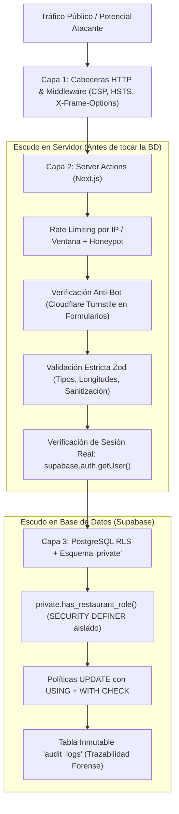

# Especificación de Arquitectura, Modelo de Datos y Seguridad Defensiva (ADR-001 + Schema Spec)

> **Estado:**Decisiones base validadas con el usuario  
> **Enfoque:** Multi-Tenant estricto, Defensa en Profundidad (Hardened Security) y flujo híbrido Supabase MCP + Git Migrations.

---

## 1. ADR-001: Decisiones Arquitectónicas y de Producto Acordadas

| ID | Decisión | Elección Acordada | Justificación Técnica y Comercial |
|---|---|---|---|
| **D1** | **Variantes en Menú (`products`)** | **Grupos de opciones simples e informativas** (`product_option_groups` + `product_options`), sin inventario ni POS. | Permite modelar platos reales (ej. *Término de cocción*, *Guarnición a elegir*, *Media porción / Porción completa*) desde el día 1 sin acoplar facturación ni stock. |
| **D2** | **Modelo Multi-Sede (`locations`)** | **Sedes con metadatos propios** (dirección, mapa, horarios, WhatsApp) y cartas (`menus`) a nivel de restaurante o asignables opcionalmente a una sede (`location_id NULLABLE`). | Evita la complejidad prematura de tablas de *overrides* por plato-sede, resolviendo el 95% de los casos reales con máxima claridad en el dashboard. |
| **D3** | **Flujo de Solicitudes de Eventos (`event_inquiries`)** | **Persistencia obligatoria en PostgreSQL + Handoff asistido a WhatsApp.** | Garantiza cero pérdida de leads si el usuario cierra WhatsApp antes de enviar, habilita el embudo comercial en el Dashboard y mantiene trazabilidad legal (Habeas Data). |
| **D4** | **Ventaja Competitiva Visual** | **Fotografía Pro (iPhone 17 Pro Max) + Dirección Visual IA fiel al producto + Modo Tipográfico Editorial.** | El sistema prioriza el lucimiento de fotografía gastronómica de alta fidelidad (Retina WebP/AVIF + *blur placeholders*), manteniendo un layout tipográfico limpio para ítems que no requieren foto (ej. gaseosas o adiciones sueltas). |
| **D5** | **Concepto de Marca Demo** | **"Casa Brasa — Fuego, Corte & Salón"** (Cocina a la leña, cortes madurados, coctelería de autor y salones privados para eventos corporativos y celebraciones). | Es el arquetipo gastronómico que mejor luce tanto en fotografía de producto (texturas de brasa, cócteles) como en venta de eventos de alto ticket (cenas de empresa, aniversarios, cumpleaños). |
| **D6** | **Gestión de Supabase (MCP + Git)** | **Flujo Híbrido: Servidor MCP dedicado por proyecto (`read_only=false`) + Migraciones SQL en `supabase/migrations/`.** | Combina la velocidad del MCP (`execute_sql`, `get_advisors`, `generate_typescript_types`) con el respaldo inmutable del esquema en Git. |

---

## 2. Opinión Técnica: Cómo configurar Supabase MCP de forma segura para este proyecto

Actualmente tu archivo global [mcp_config.json](file:///Users/fenbsru/.gemini/config/mcp_config.json#L17-L19) tiene configurado un servidor `"supabase"` que apunta a otro proyecto (`project_ref=oegwbwkpcpmxhpwfuojf`) y está en modo solo lectura (`read_only=true`), además de que no tienes instalado el binario local de `supabase` CLI en macOS.

### Nuestra recomendación (`Technical Lead` + `Security Engineer`)
Usar **Supabase MCP es la mejor decisión para tu flujo en Antigravity**, siempre que apliquemos estas tres reglas profesionales:

1. **Aislamiento por `project_ref` (Project Scoping):**
   No debemos usar una conexión MCP abierta a toda tu cuenta sin filtro, ni reutilizar el `project_ref` de otro proyecto. Configuraremos una entrada específica para este proyecto apuntando al nuevo `project_ref` de la plataforma de restaurantes:
   ```json
   "supabase-restaurants": {
     "url": "https://mcp.supabase.com/mcp?project_ref=<TU_NUEVO_PROJECT_REF>&features=docs%2Caccount%2Cdatabase%2Cdebugging%2Cdevelopment%2Cfunctions%2Cbranching%2Cstorage"
   }
   ```
   *(Al omitir `read_only=true`, tendremos permisos para crear tablas, políticas RLS y ejecutar auditorías, pero únicamente dentro del proyecto de restaurantes).*
2. **Doble registro (MCP en vivo + Archivo `.sql` en Git):**
   Cada vez que apliquemos o validemos cambios de esquema mediante el MCP de Supabase, guardaremos exactamente el mismo SQL en `supabase/migrations/YYYYMMDDHHMMSS_<nombre>.sql` dentro del repositorio. Así nunca dependemos exclusivamente de la nube y tu código fuente es 100% reproducible.
3. **Auditoría automatizada obligatoria con `get_advisors`:**
   El MCP oficial de Supabase incluye la herramienta `get_advisors` (seguridad y rendimiento). La ejecutaremos después de cada cambio de base de datos para verificar que no quede ninguna tabla sin RLS, ninguna vista insegura ni ninguna clave foránea sin índice.

---

## 3. Arquitectura de Seguridad Defensiva ("Anti-Sabotaje / Anti-Envidiosos")

Diseñamos el sistema asumiendo que alguien malintencionado intentará enviar spam, raspar datos, forzar rutas privadas o sabotear a un restaurante cliente.



### Los 6 Frentes de Blindaje Técnico

1. **Escudo Anti-Spam y Anti-Flood en Eventos (`event_inquiries`):**
   - **Problema:** Un competidor o bot envía 5.000 solicitudes de eventos falsas para llenar la base de datos o saturar al restaurante.
   - **Solución:**
     - La tabla `public.event_inquiries` **NO permitirá `INSERT` directo desde el cliente anónimo vía PostgREST** (revocamos el insert directo anónimo o lo bloqueamos para que solo entre por canal controlado).
     - El envío se procesa exclusivamente en una **Server Action de Next.js** que valida:
       1. **Campo Honeypot oculto** (si viene lleno, se descarta silenciosamente).
       2. **Token de Cloudflare Turnstile** (gratuito, invisible para humanos y letal contra scripts/bots).
       3. **Rate Limiting por IP y por teléfono/email** (máximo 3 solicitudes por IP cada 15 minutos, verificado en servidor/base de datos).
       4. **Esquema Zod estricto:** validación de formato de teléfono, email, rango lógico de invitados (`min_guests` a `max_guests`), fecha futura válida y límites de caracteres en notas (`CHECK (length(notes) <= 1000)`).
2. **Aislamiento Multi-Tenant Impenetrable (Anti-IDOR / Anti-BOLA):**
   - Todas las tablas de negocio llevan `restaurant_id UUID NOT NULL`.
   - Jamás confiamos en un `restaurant_id` enviado desde el navegador sin verificar en la base de datos que `(SELECT auth.uid())` pertenece a `public.restaurant_members` para ese `restaurant_id`.
   - Toda política `UPDATE` incluye **tanto `USING` como `WITH CHECK`**, haciendo matemáticamente imposible que un usuario mueva un producto o categoría hacia el `restaurant_id` de otro cliente.
3. **Autenticación Verificada en Servidor (`getUser` vs `getSession`):**
   - En Next.js Server Components y Server Actions, **nunca** usaremos `supabase.auth.getSession()` para autorizar acciones, ya que solo lee la cookie sin revalidar contra el servidor Auth. Usaremos siempre `supabase.auth.getUser()`, que verifica criptográficamente el token activo.
   - Prohibición total de usar `raw_user_meta_data` para roles.
4. **Blindaje de Supabase Storage:**
   - El rol `anon` tiene **cero permisos** de `INSERT`, `UPDATE` o `DELETE` en Storage.
   - Los usuarios autenticados solo pueden escribir dentro del prefijo exacto `{restaurant_id}/...` de su propio restaurante, con límite de tamaño de archivo (máx. 5 MB) y lista blanca estricta de MIME types (`image/webp`, `image/avif`, `image/jpeg`, `image/png`) configurada a nivel de bucket en `storage.buckets`.
5. **Auditoría Forense Inmutable (`public.audit_logs`):**
   - Cualquier cambio administrativo sensible (cambio de precio de un plato, desactivación de carta, cambio de WhatsApp del restaurante, cambio de estado de un evento) registra una fila en `audit_logs` con `restaurant_id`, `actor_user_id`, `action`, `entity_type`, `entity_id`, `old_data` (`JSONB`) y `new_data` (`JSONB`).
   - Nadie (ni siquiera el `owner` del restaurante desde el dashboard) tiene políticas RLS de `UPDATE` o `DELETE` sobre `audit_logs`: el historial no se puede borrar.
6. **Cumplimiento Legal de Datos Personales (Ley 1581 de 2012 / Habeas Data Colombia):**
   - Cada registro en `event_inquiries` exige `privacy_accepted BOOLEAN NOT NULL CHECK (privacy_accepted = true)`, almacena `privacy_accepted_at TIMESTAMPTZ NOT NULL DEFAULT now()` y guarda la versión o hash del texto legal aceptado (`privacy_policy_version TEXT NOT NULL`).

---

## 4. Esquema Relacional Detallado (PostgreSQL 3NF)

Siguiendo las reglas de `postgresql-table-design` y `supabase-postgres-best-practices`:
- Cero `VARCHAR(n)` ni `TIMESTAMP` sin zona horaria; usamos `TEXT` con `CHECK (length(...) <= N)` y `TIMESTAMPTZ`.
- Cero `FLOAT` para dinero; usamos `NUMERIC(12, 2)`.
- Todos los campos FK tienen índices B-tree explícitos empezando por `restaurant_id`.

### 4.1 Esquema Privado de Seguridad (`private`)
```sql
CREATE SCHEMA IF NOT EXISTS private;

-- Verifica si el usuario autenticado actual tiene uno de los roles permitidos en el restaurante
CREATE OR REPLACE FUNCTION private.has_restaurant_role(
  target_restaurant_id uuid,
  allowed_roles text[] DEFAULT ARRAY['owner', 'admin', 'editor']
)
RETURNS boolean
LANGUAGE sql
SECURITY DEFINER
STABLE
SET search_path = ''
AS $$
  SELECT EXISTS (
    SELECT 1
    FROM public.restaurant_members rm
    WHERE rm.restaurant_id = target_restaurant_id
      AND rm.user_id = (SELECT auth.uid())
      AND rm.role = ANY(allowed_roles)
      AND rm.is_active = true
  );
$$;

REVOKE ALL ON FUNCTION private.has_restaurant_role(uuid, text[]) FROM PUBLIC, anon;
GRANT EXECUTE ON FUNCTION private.has_restaurant_role(uuid, text[]) TO authenticated;
```

### 4.2 Tablas del Núcleo Multi-Tenant (`restaurants`, `locations`, `restaurant_members`)
- **`public.restaurants`**:
  - `id` (`uuid PRIMARY KEY DEFAULT gen_random_uuid()`)
  - `slug` (`text NOT NULL UNIQUE CHECK (slug ~ '^[a-z0-9-]+$' AND length(slug) BETWEEN 3 AND 60)`)
  - `name` (`text NOT NULL CHECK (length(name) BETWEEN 2 AND 120)`)
  - `tagline` (`text CHECK (length(tagline) <= 200)`)
  - `story_excerpt` (`text CHECK (length(story_excerpt) <= 1500)`)
  - `cuisine_type` (`text CHECK (length(cuisine_type) <= 80)`)
  - `currency_code` (`text NOT NULL DEFAULT 'COP' CHECK (length(currency_code) = 3)`)
  - `is_demo` (`boolean NOT NULL DEFAULT false`)
  - `is_published` (`boolean NOT NULL DEFAULT false`)
  - `enabled_modules` (`jsonb NOT NULL DEFAULT '{"menu": true, "events": true, "site": true}'::jsonb`)
  - `theme_config` (`jsonb NOT NULL DEFAULT '{}'::jsonb` — arquetipo editorial, paleta semántica, fuentes, hero asset)
  - `contact_config` (`jsonb NOT NULL DEFAULT '{}'::jsonb` — WhatsApp principal, Instagram, email comercial, texto legal Habeas Data)
  - `created_at`, `updated_at` (`timestamptz NOT NULL DEFAULT now()`)

- **`public.locations`** (Sedes del restaurante):
  - `id` (`uuid PRIMARY KEY DEFAULT gen_random_uuid()`)
  - `restaurant_id` (`uuid NOT NULL REFERENCES public.restaurants(id) ON DELETE CASCADE`)
  - `slug` (`text NOT NULL CHECK (slug ~ '^[a-z0-9-]+$')`)
  - `name` (`text NOT NULL CHECK (length(name) <= 100)`)
  - `address_line` (`text NOT NULL CHECK (length(address_line) <= 250)`)
  - `neighborhood` (`text CHECK (length(neighborhood) <= 100)`)
  - `city` (`text NOT NULL DEFAULT 'Bogotá' CHECK (length(city) <= 100)`)
  - `google_maps_url` (`text CHECK (length(google_maps_url) <= 500)`)
  - `whatsapp_phone` (`text CHECK (whatsapp_phone ~ '^\+?[0-9]{10,15}$')`)
  - `contact_phone` (`text CHECK (length(contact_phone) <= 30)`)
  - `opening_hours` (`jsonb NOT NULL DEFAULT '[]'::jsonb`)
  - `is_primary` (`boolean NOT NULL DEFAULT false`)
  - `is_active` (`boolean NOT NULL DEFAULT true`)
  - `sort_order` (`integer NOT NULL DEFAULT 0`)
  - `UNIQUE (restaurant_id, slug)`

- **`public.restaurant_members`** (Control de Acceso RBAC por Tenant):
  - `id` (`uuid PRIMARY KEY DEFAULT gen_random_uuid()`)
  - `restaurant_id` (`uuid NOT NULL REFERENCES public.restaurants(id) ON DELETE CASCADE`)
  - `user_id` (`uuid NOT NULL REFERENCES auth.users(id) ON DELETE CASCADE`)
  - `role` (`text NOT NULL CHECK (role IN ('owner', 'admin', 'editor'))`)
  - `is_active` (`boolean NOT NULL DEFAULT true`)
  - `created_at` (`timestamptz NOT NULL DEFAULT now()`)
  - `UNIQUE (restaurant_id, user_id)`

### 4.3 Tablas del Módulo 1: Menú Digital Inteligente
- **`public.menus`** (Cartas del restaurante, ej. *Carta Principal*, *Coctelería & Cava*, *Menú de Mediodía*):
  - `id` (`uuid PRIMARY KEY DEFAULT gen_random_uuid()`)
  - `restaurant_id` (`uuid NOT NULL REFERENCES public.restaurants(id) ON DELETE CASCADE`)
  - `location_id` (`uuid REFERENCES public.locations(id) ON DELETE SET NULL` — `NULL` significa disponible en todas las sedes)
  - `slug` (`text NOT NULL`)
  - `name` (`text NOT NULL CHECK (length(name) <= 100)`)
  - `description` (`text CHECK (length(description) <= 300)`)
  - `schedule_label` (`text CHECK (length(schedule_label) <= 120)` — ej. *"Todos los días de 12:00 m. a 11:00 p. m."*)
  - `is_active` (`boolean NOT NULL DEFAULT true`)
  - `sort_order` (`integer NOT NULL DEFAULT 0`)
  - `UNIQUE (restaurant_id, slug)`

- **`public.categories`**:
  - `id` (`uuid PRIMARY KEY DEFAULT gen_random_uuid()`)
  - `restaurant_id` (`uuid NOT NULL REFERENCES public.restaurants(id) ON DELETE CASCADE`)
  - `menu_id` (`uuid NOT NULL REFERENCES public.menus(id) ON DELETE CASCADE`)
  - `slug` (`text NOT NULL`)
  - `name` (`text NOT NULL CHECK (length(name) <= 100)`)
  - `description` (`text CHECK (length(description) <= 300)`)
  - `display_mode` (`text NOT NULL DEFAULT 'editorial_grid' CHECK (display_mode IN ('editorial_grid', 'compact_list', 'featured_cards'))` — permite que categorías sin foto como vinos/bebidas se rendericen como lista tipográfica de lujo)
  - `is_active` (`boolean NOT NULL DEFAULT true`)
  - `sort_order` (`integer NOT NULL DEFAULT 0`)
  - `UNIQUE (menu_id, slug)`

- **`public.products`**:
  - `id` (`uuid PRIMARY KEY DEFAULT gen_random_uuid()`)
  - `restaurant_id` (`uuid NOT NULL REFERENCES public.restaurants(id) ON DELETE CASCADE`)
  - `category_id` (`uuid NOT NULL REFERENCES public.categories(id) ON DELETE CASCADE`)
  - `slug` (`text NOT NULL`)
  - `name` (`text NOT NULL CHECK (length(name) <= 140)`)
  - `short_description` (`text CHECK (length(short_description) <= 280)`)
  - `long_description` (`text CHECK (length(long_description) <= 1000)`)
  - `base_price` (`numeric(12,2) NOT NULL CHECK (base_price >= 0)`)
  - `compare_at_price` (`numeric(12,2) CHECK (compare_at_price IS NULL OR compare_at_price >= base_price)`)
  - `image_url` (`text CHECK (length(image_url) <= 600)`)
  - `image_alt` (`text CHECK (length(image_alt) <= 200)`)
  - `availability_status` (`text NOT NULL DEFAULT 'available' CHECK (availability_status IN ('available', 'sold_out', 'hidden', 'archived'))`)
  - `is_featured` (`boolean NOT NULL DEFAULT false`)
  - `is_new` (`boolean NOT NULL DEFAULT false`)
  - `Chef_recommendation` / `badges` (`text[] NOT NULL DEFAULT '{}'` — ej. `ARRAY['brasa', 'recomendado_chef', 'sin_gluten', 'picante_suave']`)
  - `portion_info` (`text CHECK (length(portion_info) <= 80)` — ej. *"400g en crudo · Ideal para compartir"*)
  - `sort_order` (`integer NOT NULL DEFAULT 0`)
  - `UNIQUE (category_id, slug)`

- **`public.product_option_groups`** (Grupos de variantes simples acordados en **D1**, ej. *Término de la carne*, *Guarnición incluida*, *Tamaño*):
  - `id` (`uuid PRIMARY KEY DEFAULT gen_random_uuid()`)
  - `restaurant_id` (`uuid NOT NULL REFERENCES public.restaurants(id) ON DELETE CASCADE`)
  - `product_id` (`uuid NOT NULL REFERENCES public.products(id) ON DELETE CASCADE`)
  - `name` (`text NOT NULL CHECK (length(name) <= 80)`)
  - `is_required` (`boolean NOT NULL DEFAULT false`)
  - `min_selections` (`integer NOT NULL DEFAULT 0 CHECK (min_selections >= 0)`)
  - `max_selections` (`integer NOT NULL DEFAULT 1 CHECK (max_selections >= 1)`)
  - `sort_order` (`integer NOT NULL DEFAULT 0`)

- **`public.product_options`** (Opciones dentro del grupo, ej. *Término Medio (+ \$0)*, *Papas trufadas (+ \$8.000)*):
  - `id` (`uuid PRIMARY KEY DEFAULT gen_random_uuid()`)
  - `restaurant_id` (`uuid NOT NULL REFERENCES public.restaurants(id) ON DELETE CASCADE`)
  - `option_group_id` (`uuid NOT NULL REFERENCES public.product_option_groups(id) ON DELETE CASCADE`)
  - `name` (`text NOT NULL CHECK (length(name) <= 100)`)
  - `price_delta` (`numeric(12,2) NOT NULL DEFAULT 0 CHECK (price_delta >= 0)`)
  - `is_available` (`boolean NOT NULL DEFAULT true`)
  - `sort_order` (`integer NOT NULL DEFAULT 0`)

### 4.4 Tablas del Módulo 2: Sistema Comercial de Eventos y Celebraciones
- **`public.event_spaces`** (Salones, terrazas, cavas privadas):
  - `id` (`uuid PRIMARY KEY DEFAULT gen_random_uuid()`)
  - `restaurant_id` (`uuid NOT NULL REFERENCES public.restaurants(id) ON DELETE CASCADE`)
  - `location_id` (`uuid REFERENCES public.locations(id) ON DELETE SET NULL`)
  - `slug` (`text NOT NULL`)
  - `name` (`text NOT NULL CHECK (length(name) <= 120)`)
  - `subtitle` (`text CHECK (length(subtitle) <= 180)`)
  - `description` (`text NOT NULL CHECK (length(description) <= 1500)`)
  - `capacity_seated` (`integer NOT NULL CHECK (capacity_seated > 0)`)
  - `capacity_cocktail` (`integer CHECK (capacity_cocktail IS NULL OR capacity_cocktail >= capacity_seated)`)
  - `min_guests` (`integer NOT NULL DEFAULT 10 CHECK (min_guests > 0)`)
  - `features` (`text[] NOT NULL DEFAULT '{}'` — ej. `ARRAY['Audio privado', 'Pantalla / Proyector', 'Climatizado', 'Terraza cubierta']`)
  - `gallery_urls` (`jsonb NOT NULL DEFAULT '[]'::jsonb`)
  - `is_active` (`boolean NOT NULL DEFAULT true`)
  - `sort_order` (`integer NOT NULL DEFAULT 0`)

- **`public.event_packages`** (Paquetes comerciales configurables):
  - `id` (`uuid PRIMARY KEY DEFAULT gen_random_uuid()`)
  - `restaurant_id` (`uuid NOT NULL REFERENCES public.restaurants(id) ON DELETE CASCADE`)
  - `slug` (`text NOT NULL`)
  - `name` (`text NOT NULL CHECK (length(name) <= 120)`)
  - `event_category` (`text NOT NULL CHECK (event_category IN ('corporate', 'birthday', 'anniversary', 'family_celebration', 'private_dining', 'custom'))`)
  - `tagline` (`text CHECK (length(tagline) <= 200)`)
  - `description` (`text NOT NULL CHECK (length(description) <= 1500)`)
  - `pricing_model` (`text NOT NULL CHECK (pricing_model IN ('per_person', 'fixed_package', 'custom_quote'))`)
  - `base_price` (`numeric(12,2) CHECK (base_price IS NULL OR base_price >= 0)`)
  - `min_guests` (`integer NOT NULL DEFAULT 10 CHECK (min_guests > 0)`)
  - `max_guests` (`integer CHECK (max_guests IS NULL OR max_guests >= min_guests)`)
  - `includes_items` (`jsonb NOT NULL DEFAULT '[]'::jsonb` — lista estructurada de lo que incluye: entrada, fuerte, bebida, decoración/montaje, tiempo de salón)
  - `optional_extras` (`jsonb NOT NULL DEFAULT '[]'::jsonb` — descorche, barra libre, sonido adicional)
  - `conditions_text` (`text CHECK (length(conditions_text) <= 1000)` — políticas de anticipo, horarios límite)
  - `cover_image_url` (`text`)
  - `is_featured` (`boolean NOT NULL DEFAULT false`)
  - `is_active` (`boolean NOT NULL DEFAULT true`)
  - `sort_order` (`integer NOT NULL DEFAULT 0`)

- **`public.event_inquiries`** (Solicitudes de cotización / Leads blindados):
  - `id` (`uuid PRIMARY KEY DEFAULT gen_random_uuid()`)
  - `reference_code` (`text NOT NULL UNIQUE` — código corto legible ej. `CB-2026-8492` para mostrar al cliente y pasar al mensaje de WhatsApp)
  - `restaurant_id` (`uuid NOT NULL REFERENCES public.restaurants(id) ON DELETE CASCADE`)
  - `location_id` (`uuid REFERENCES public.locations(id) ON DELETE SET NULL`)
  - `event_space_id` (`uuid REFERENCES public.event_spaces(id) ON DELETE SET NULL`)
  - `event_package_id` (`uuid REFERENCES public.event_packages(id) ON DELETE SET NULL`)
  - `event_type` (`text NOT NULL CHECK (length(event_type) <= 80)`)
  - `tentative_date` (`date NOT NULL`)
  - `preferred_time_slot` (`text NOT NULL CHECK (preferred_time_slot IN ('lunch', 'afternoon', 'dinner', 'full_evening'))`)
  - `guest_count` (`integer NOT NULL CHECK (guest_count BETWEEN 2 AND 1000)`)
  - `customer_name` (`text NOT NULL CHECK (length(customer_name) BETWEEN 2 AND 120)`)
  - `customer_phone` (`text NOT NULL CHECK (length(customer_phone) BETWEEN 7 AND 25)`)
  - `customer_email` (`text CHECK (customer_email IS NULL OR length(customer_email) <= 160)`)
  - `company_name` (`text CHECK (length(company_name) <= 120)`)
  - `special_requests` (`text CHECK (length(special_requests) <= 1000)`)
  - `status` (`text NOT NULL DEFAULT 'received' CHECK (status IN ('received', 'contacted', 'quoted', 'confirmed', 'rejected', 'archived'))`)
  - `internal_admin_notes` (`text CHECK (length(internal_admin_notes) <= 2000)`)
  - `privacy_accepted` (`boolean NOT NULL CHECK (privacy_accepted = true)`)
  - `privacy_accepted_at` (`timestamptz NOT NULL DEFAULT now()`)
  - `privacy_policy_version` (`text NOT NULL DEFAULT 'v1.0-CO-1581'`)
  - `source_ip_hash` (`text` — hash SHA-256 con salt de la IP solo para rate-limiting anti-spam sin guardar el dato personal de la IP en claro)
  - `created_at`, `updated_at` (`timestamptz NOT NULL DEFAULT now()`)

### 4.5 Tablas de Seguridad, Rate Limiting y Auditoría
- **`public.audit_logs`**:
  - `id` (`bigint GENERATED ALWAYS AS IDENTITY PRIMARY KEY`)
  - `restaurant_id` (`uuid NOT NULL REFERENCES public.restaurants(id) ON DELETE CASCADE`)
  - `actor_user_id` (`uuid REFERENCES auth.users(id) ON DELETE SET NULL`)
  - `action` (`text NOT NULL CHECK (length(action) <= 80)`)
  - `entity_type` (`text NOT NULL CHECK (length(entity_type) <= 60)`)
  - `entity_id` (`uuid`)
  - `previous_state` (`jsonb`)
  - `new_state` (`jsonb`)
  - `created_at` (`timestamptz NOT NULL DEFAULT now()`)

- **`private.rate_limit_buckets`** (En esquema `private`, inaccesible desde la API pública):
  - Controla intentos por `ip_hash` + `action_key` en ventanas deslizantes para bloquear ataques de fuerza bruta o spam antes de procesar mutaciones públicas.

---

## 5. Matriz de Políticas RLS por Tabla y Rol

| Tabla | `SELECT` (`anon`) | `SELECT` (`authenticated`) | `INSERT` (`authenticated`) | `UPDATE` (`authenticated`) | `DELETE` (`authenticated`) |
|---|---|---|---|---|---|
| `restaurants` | Solo si `is_published = true` | Si `is_published = true` **O** es miembro (`owner/admin/editor`) | Bloqueado en cliente (solo aprovisionamiento controlado) | Solo `owner` / `admin` (`USING` + `WITH CHECK`) | Bloqueado |
| `locations`, `menus`, `categories`, `event_spaces`, `event_packages` | Solo si `is_active = true` y su restaurante está publicado | Público activo **O** miembro del restaurante | Miembro (`owner`, `admin`, `editor`) con `WITH CHECK` | Miembro (`owner`, `admin`, `editor`) con `USING` + `WITH CHECK` | Solo `owner` / `admin` |
| `products`, `product_option_groups`, `product_options` | Solo si `availability_status IN ('available', 'sold_out')` (nunca `hidden` ni `archived`) | Público visible **O** miembro del restaurante | Miembro (`owner`, `admin`, `editor`) | Miembro (`owner`, `admin`, `editor`) con `USING` + `WITH CHECK` | Solo `owner` / `admin` |
| `event_inquiries` | **DENEGADO (0 acceso)** | **Solo miembros del restaurante (`owner`, `admin`, `editor`)** | Vía función segura / Server Action validada con Turnstile + Rate Limit | Miembro (`owner`, `admin`, `editor`) para cambiar `status` y notas | Solo `owner` |
| `restaurant_members` | **DENEGADO** | Solo miembros del mismo `restaurant_id` | Solo `owner` del restaurante | Solo `owner` del restaurante | Solo `owner` del restaurante |
| `audit_logs` | **DENEGADO** | Solo `owner` y `admin` del restaurante | Inserción automática por triggers/funciones en cambios sensibles | **DENEGADO (Inmutable)** | **DENEGADO (Inmutable)** |
